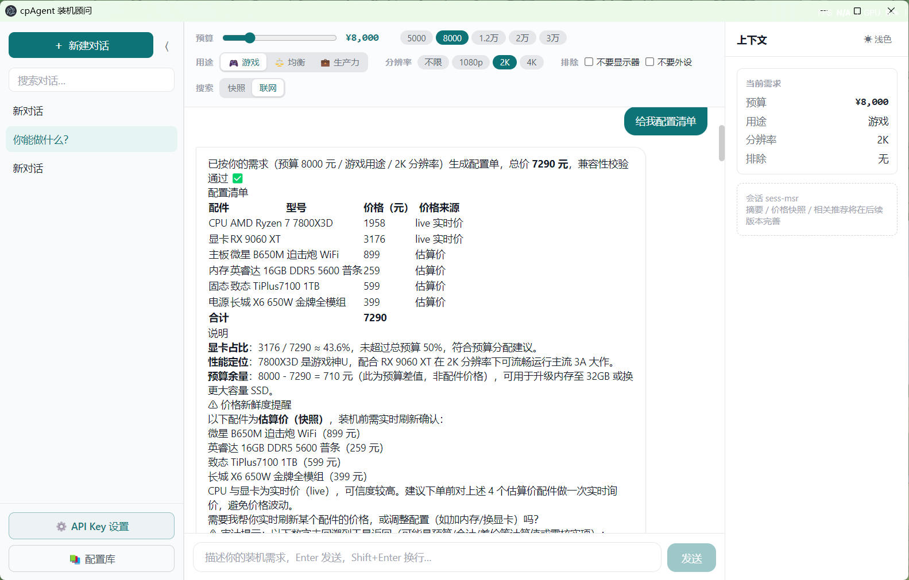
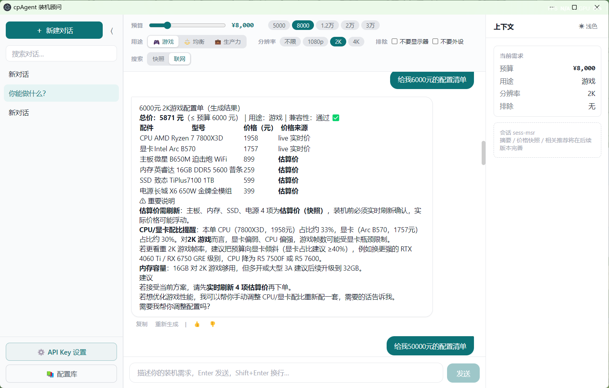
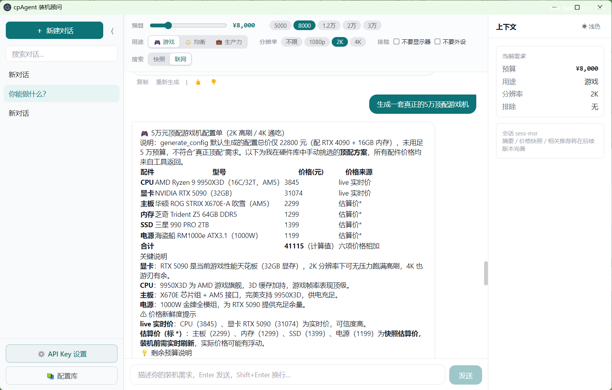

# cpAgent

桌面装机顾问 Agent。说一句「8000 打游戏 2K 不要显示器」，出一张能查证的配置单，
另外支持配件对比、行情答疑和多轮追问。

## 配置单是怎么出来的

模型只做两件事：听懂需求、决定调哪个工具。配置单本身由后端的确定性算法拼，
价格和规格全部取自工具返回或本地硬件库（67 条），每条带来源和抓取时间。

分开的原因是型号和价格都得有唯一事实来源：要么来自数据源，要么不存在。
模型没有拼装权，也就没有地方写一个"看起来很像"的型号进去。

## 实测（都能重跑）

```bash
python scripts/test_m2.py                                        # → 51 项通过
python -m uvicorn backend.server:app --host 127.0.0.1 --port 8765
```

| 项目 | 实测结果 | 怎么复现 |
|---|---|---|
| 确定性 | 同一需求连跑 5 次，剥离 `id` / `generated_at` 后配置单**完全一致** | 连打 5 次 `POST /config` 比对 |
| 预算利用率 | 8000 → 实配 7875（98.4%）；12000 → 11608（96.7%） | `POST /config` 看 `total_price` |
| 生成耗时 | 0.48 s（8000）→ 1.30 s（20000），预算越大候选组合越多 | 同上 |
| 价格溯源 | 6 类配件 100% 带 `price_source` / `fetched_at` / `confidence` | 看 `parts[*]` |
| 价格新鲜度 | 实测 5 个 `expired` + 1 个 `unknown`，估算价另出 `warnings` | 看 `price_freshness` |
| 兼容性 | `compatibility.ok` + `problems` 列表，不合格的组合直接不进结果 | 看 `compatibility` |
| 用途归一 | 12 组同义词（游戏 / 打游戏 / 视频剪辑 / 剪视频 / 渲染 / 均衡…） | `python scripts/test_m2.py` |

## MCP Server

除了 HTTP 接口，配置能力按 MCP 协议也暴露了一份。Claude Desktop、Cursor 这类
客户端可以直接当工具调，不用自己写 HTTP 客户端。

```bash
python -m backend.mcp_server
```

客户端侧配置：

```json
{
  "mcpServers": {
    "cpagent": {
      "command": "python",
      "args": ["-m", "backend.mcp_server"],
      "cwd": "<cpAgent 仓库根目录>"
    }
  }
}
```

三个工具：

| 工具 | 作用 |
|---|---|
| `generate_pc_config` | 按预算出配置单，返回型号 / 价格 / 来源 / 新鲜度 |
| `check_budget` | 先查预算能不能配出来，避免把 422 当答案丢给用户 |
| `list_hardware` | 按品类列候选，按价格升序 |

只暴露确定性能力，不把需要 LLM 的对话放出去 —— 给别的 Agent 当工具用的东西必须可复现，
不能我调一次一个结果。

## 技术栈

Electron + React 18 + TypeScript + Zustand + Tailwind，后端 FastAPI + ReAct 循环 + SQLite，
SSE 流式返回。

## 界面截图

<div align="center">
  
  
  
</div>

## 快速开始

```bash
# 后端（127.0.0.1:8765）
python -m backend.server

# 前端
cd frontend && npm install && npm run dev
```

在工程根目录 `.env` 配置 `DEEPSEEK_API_KEY`，或用 `CPAGENT_LLM_PROVIDER=ollama` 接本地模型，
也可以用 `mock` 完全离线跑通全链路。

## 还没做的

- `top_k` 出的多套方案只是"同价位换件"（比如内存换个牌子，总价一样），
  不是不同取舍的配置。要做真多方案，得让评分权重随用途变
- `use_case` 在预算宽裕时会收敛到同一套（最优件两个维度都强），
  这个参数在 12000 以上基本退化成无效参数
- 价格只有快照和刷新两种模式，没有增量更新
- 硬件库是手工整理的 67 条，覆盖面比不过电商接口

路线图见 `PROJECT_PLAN.md`。
